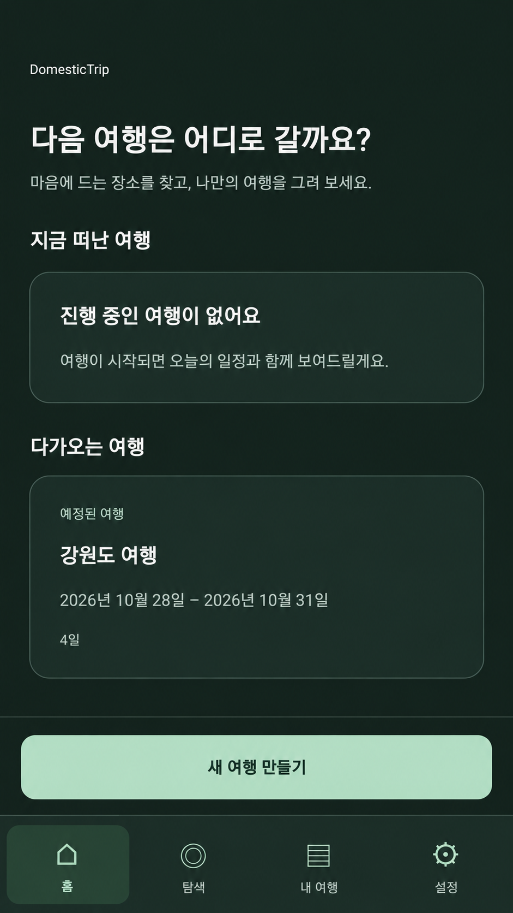
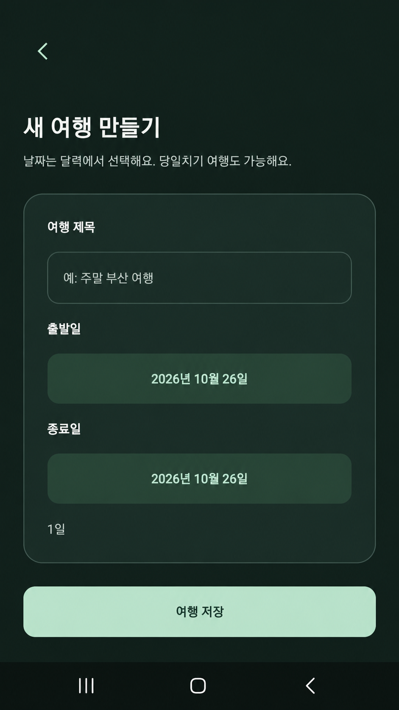
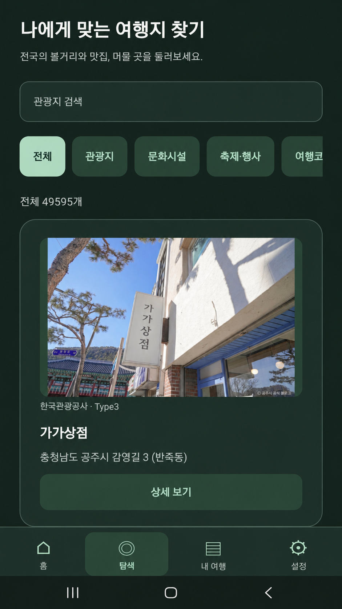
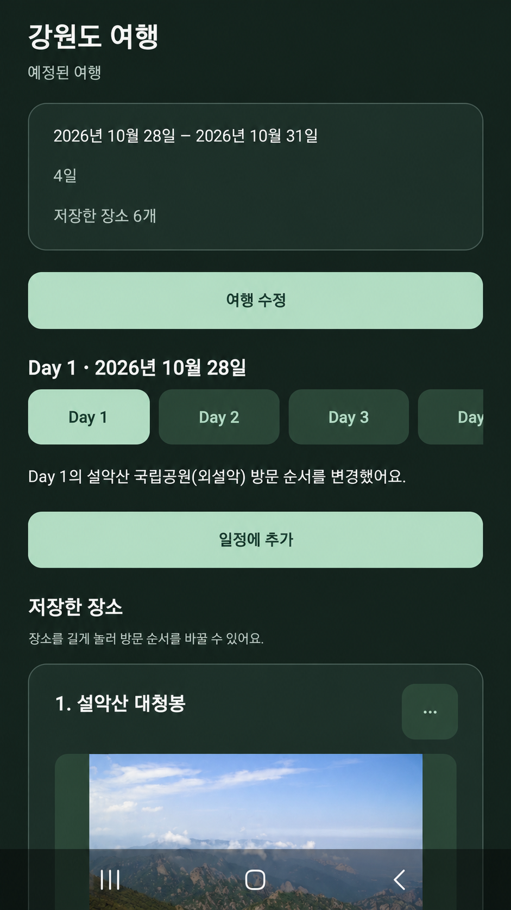

# DomesticTrip

국내 관광지를 검색하고 **어느 날, 어떤 순서로 방문할지** 정리하는 iOS·Android 여행 일정 앱입니다. 여행과 일정은 기기에 저장하며, 한국어·영어 관광정보를 지원합니다.

## 구현한 MVP

- 달력으로 여행 생성·수정, 예정·여행 중·지난 여행 관리
- TourAPI 관광지 검색·카테고리 탐색·상세 조회와 무한 스크롤
- Day별 장소 추가·이동·제거, 중복 경고와 드래그 순서 변경
- 한국어·영어 지원, 기기에 여행·일정·언어 설정 저장

방문 시간, 지도·경로 최적화, 직접 입력한 장소, 로그인·공유·클라우드 동기화는 범위에서 제외했습니다.

## 실제 화면

| 홈                                                                                                 | 여행 생성                                                                                                            | 탐색                                                                                                            | 내 여행 상세                                                                                                      |
| -------------------------------------------------------------------------------------------------- | -------------------------------------------------------------------------------------------------------------------- | --------------------------------------------------------------------------------------------------------------- | ----------------------------------------------------------------------------------------------------------------- |
|  |  |  |  |

## 기술과 구조

TypeScript · React Native · Expo SDK 58 · Expo Router · expo-sqlite · TanStack Query v5 · i18next/react-i18next · expo-image · 네이티브 날짜 선택기 · react-native-draglist

```text
src/app/               화면 진입점과 라우팅
src/features/trips/    여행·Day 도메인, 조회 훅과 일정 편집 UI
src/features/places/   TourAPI 클라이언트·검증·Mapper, Query 훅과 관광지 UI
src/database/          스키마, 트랜잭션, 여행·장소 Repository와 설정 저장
src/shared/            공통 UI, 디자인 토큰, 날짜 처리와 언어 설정
```

화면에서 SQL이나 API 응답을 직접 다루지 않도록 데이터 접근과 변환을 분리했습니다. 기능 기준은 [기획 문서](docs/PRODUCT_SPEC.md)에 정리했습니다.

## 설계하면서 고민한 점

### 여행 날짜가 바뀌어도 일정은 유지하기

출발일을 바꿀 때마다 짜 둔 일정을 다시 옮기지 않아도 되도록, 장소를 날짜 대신 Day 번호에 연결했습니다. 실제 날짜는 출발일을 기준으로 계산하고, 오늘과 여행 상태는 한국 시간으로 판단합니다. 기간을 줄일 때 사라지는 Day에 장소가 있다면 바로 저장하지 않고 먼저 이동하거나 정리하도록 안내합니다.

### 한국어·영어 관광정보를 같은 화면에서 사용하기

TourAPI의 한국어·영어 서비스는 카테고리 ID가 다르고, 관광지 ID도 언어 간 대응을 보장하지 않습니다. 화면마다 이를 처리하지 않도록 공통 모델로 변환했습니다. 장소는 언어와 ID를 함께 관리해 데이터가 섞이지 않게 하고, 저장한 관광지 원문은 앱 언어를 바꿔도 그대로 보여줍니다.

### 관광정보 조회가 실패해도 내 일정은 열 수 있게 하기

외부 API 상태 때문에 이미 만든 여행을 볼 수 없게 되는 상황을 피하고 싶었습니다. 조회 결과는 TanStack Query로 캐시하고, 일정에 추가한 장소의 표시 정보는 여행과 함께 SQLite에 따로 저장했습니다. 장소 이동·순서 변경·삭제에는 트랜잭션을 적용해 변경 도중 일부만 저장되지 않도록 했습니다.

## 동작 확인

Codex를 통해 iOS Simulator와 Android Emulator의 Expo Go에서 주요 흐름을 수동으로 확인했습니다(2026-10-20).

- 여행 생성 후 앱을 종료·재실행해 저장 유지 확인
- 관광지 검색·추가, Day 이동과 드래그 순서 변경 확인
- 지난 여행 수정·삭제와 기간 단축 시 기존 장소 보호 확인
- 한국어·영어 전환 후 설정과 저장된 일정 보존 확인

Android에서는 네트워크를 끈 상태의 검색 오류와 기존 일정 조회도 확인했습니다. 국문·영문 TourAPI의 실제 목록·검색·상세 응답은 별도 요청으로 확인했습니다.

실기기와 독립 배포 빌드, iOS 오프라인 동작은 아직 검증하지 않았습니다. 접근성은 일부만 확인했으며, VoiceOver 음성 읽기를 포함한 전체 사용 흐름은 추가 확인이 필요합니다.

## 로컬 실행

```bash
npm ci
cp .env.example .env
# .env의 EXPO_PUBLIC_TOUR_API_KEY에 본인 키를 입력
npm start
```

터미널에서 `i`(iOS) 또는 `a`(Android)를 선택합니다. Node.js·npm과 호환되는 Expo Go가 필요하며, iOS Simulator는 macOS와 Xcode가 필요합니다.

키는 TourAPI의 `KorService2`·`EngService2` 이용이 가능해야 합니다. `EXPO_PUBLIC_*` 값은 앱에 포함되므로 비밀 보관 수단이 아니며, 실제 `.env`와 키·서명 파일은 Git에 올리지 않습니다.

일정은 기기에 저장하므로 앱 데이터 삭제·앱 제거 시 사라집니다. 오프라인에서 저장한 일정은 읽을 수 있지만 이미지는 다시 불러오지 못할 수 있습니다. Web은 검증 대상에서 제외했고 언어 설정도 세션 범위입니다.

Android preview APK 설정은 `eas.json`에 있습니다. 빌드하려면 본인 EAS 프로젝트 연결과 preview 환경의 키를 별도로 확인해야 합니다.

## AI를 활용한 개발

직접 MVP의 기능 범위와 데이터 보존 원칙을 정하고, Codex를 활용해 기능 구현과 리팩터링을 진행했습니다. 날짜 선택과 일정 편집 흐름을 바탕으로 Day 선택, 카드 메뉴, 드래그 순서 변경 등의 UX를 개선했습니다.

주요 기능의 시뮬레이터·에뮬레이터 수동 확인도 Codex를 통해 진행했습니다.
